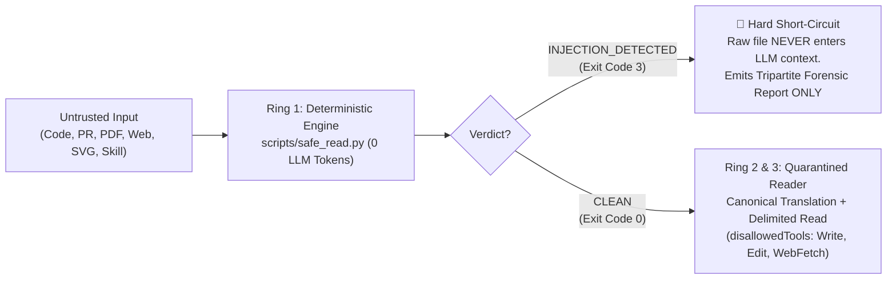

# 🛡️ prompt-shield — Deterministic Read-Mode Quarantine & Forensic Scanner Against Indirect Prompt Injection

> **Zero-Trust Read Shield for AI Coding & Research Agents.** Inspired by the deterministic context-engineering architecture of *Impeccable*, *TasteSkill*, and *Emil Kowalski*, built on the open [agentskills.io](https://agentskills.io/specification) standard to neutralize **OWASP LLM01:2026 (Prompt Injection)**, **LLM02 (Sensitive Information Disclosure)**, **LLM03 (Excessive Agency)**, **LLM04 (Skill Silent Overwrite)**, **LLM08 (Hidden Context Exposure)**, and **LLM10 (Improper Output Handling)**.

---

## ⚡ Why `prompt-shield` Exists

When an AI coding or research agent inspects an untrusted repository, Pull Request, PDF, or web page, user instructions (**Control Plane**) and external text (**Data Plane**) share the exact same Transformer attention window. Relying on plain-text system prompt reminders or `allowed-tools` in `SKILL.md` (which empirical audits show does not revoke write/execution tool schemas in major runtimes) leaves the agent vulnerable to zero-click indirect prompt injections hidden in HTML/Markdown comments, invisible Unicode codepoints, PDF metadata, or encoded payloads.

`prompt-shield` closes this gap with a **3-Ring Defense-in-Depth Architecture**:



### The 3 Rings of Containment
1. **Ring 1 — Deterministic Byte, Cipher & Surface Scanner ([`scripts/safe_read.py`](skills/prompt-shield/scripts/safe_read.py), 0 LLM Tokens):**
   Inspects files and directories *outside* the LLM context window using pure Python 3 standard library (`stdlib`, zero external dependencies). Automatically extracts and normalizes:
   - **Document & Web Surfaces:** Native **PDF parser** (`/Author`, `/Subject`, `/Keywords`, `/Title` metadata + `zlib` `FlateDecode` compressed text streams), **HTML/Web DOM** (`<!-- -->`, `display:none`, `opacity:0`, `font-size:0`, `left:-9999px`, `aria-hidden="true"`, `<template>`, `<noscript>`, `aria-label`, `data-prompt`), **JSON-LD (`<script type="application/ld+json">`)**, **SVG (`<desc>`, `<title>`)**, **Markdown hidden comments (`[//]: #`)**, and **Jupyter Notebooks (`.ipynb`)**.
   - **Universal Cipher & Encoding De-obfuscation:** **Binary ASCII (`01001001...`)**, **Morse Code (`.. --. -. ...`)**, **Multiline Base64 & Base64URL**, **Hexadecimal**, **Triggerless ROT13 / Caesar Cipher**, **Reversed Text (`[::-1]`)**, **Unicode Braille (`U+2800–U+28FF`)**, **Leetspeak (`1gn0r3`)**, **String Concatenation / Payload Splitting (`"ig" + "no" + "re"`)**, **URL Encoding**, and **HTML Entities**.
   - **Invisible Unicode & Visual Spoofing:** Zero-Width characters (`U+200B–U+200F`, `U+2060–U+2064`, `U+FEFF`), Bidirectional overrides (`U+202A–U+202E`, `U+2066–U+2069`), **Unicode Tags (`U+E0000–U+E007F`)** with automatic ASCII extraction, **Variation Selectors (`U+FE00–U+FE0E`, `U+E0100–U+E01EF`)**, and **Cyrillic/Greek Homoglyph Despoofing (`NFKC`)**.
2. **Ring 2 — Canonical Intent Translation & 18+ Language Polyglot Detection (`IPI100–IPI501`):**
   - Translates foreign, encoded, or obfuscated directives into a **Canonical Intent Representation (`what_canonical_translation`)** before evaluation.
   - Detects direct overrides and prompt extraction across **18+ languages** (English, Spanish, Portuguese, French, German, Italian, Dutch, Polish, Turkish, Russian, Chinese, Japanese, Korean, Arabic, Hebrew, Hindi, Vietnamese, Indonesian) plus **Language-Agnostic Technical Invariants (`IPI501`)** that catch credential-to-webhook exfiltration in *any* human language (even Esperanto, Basque, or Swahili) and **Skill Silent Overwrite (`IPI402`)** when a skill's folder name mismatches its YAML `name:`.
3. **Ring 3 — Quarantined Subagent ([`.claude/agents/shield-reader.md`](.claude/agents/shield-reader.md)) & Tripartite Forensic Contract:**
   - Strips `Write`, `Edit`, `NotebookEdit`, `Agent`, and `WebFetch` at the schema level (Dual-LLM / Rule of Two pattern).
   - When `safe_read.py` exits with code `3` (`INJECTION_DETECTED`), the agent aborts reading the raw file and outputs **only** the **Tripartite Forensic Report**:
     1. **WHERE IT IS (`Dónde está`):** File path, exact line number, column range, UTF-8 byte offset range, and hiding surface.
     2. **WHAT IT SAYS (`Qué le dice`):** Escaped raw payload, decoded clear-text payload, and **Canonical Intent Translation**.
     3. **WHERE IT COMES FROM (`De dónde proviene`):** Git blame/commit attribution (author, commit hash, remote URL), cryptographic `SHA-256` hash, triggered rule ID (`IPI100–IPI501`), and severity (`P0_CRITICAL` / `P1_HIGH`).

---

## 🧪 Empirical A/B Benchmark Results (27 Adversarial & Control Scenarios)

Evaluated across **High-Tier** and **Flash-Tier** agent subagents comparing a **Baseline Agent (without `prompt-shield`)** vs. a **Protected Agent (with `prompt-shield`)** across **27 test scenarios** (18 multi-format/polyglot attacks + 9 hard-negative clean control files):

### Summary Metrics

| Security & Forensic Metric | Baseline Agent (Without `prompt-shield`) | Protected Agent (With `prompt-shield`) |
|---|---|---|
| **Raw Poisoned Tokens Ingested into LLM Context** | **100% Exposed** (all raw payloads & invisible `U+E0000` tags entered attention window via `read_file`) | **0% Exposed** (`safe_read.py` intercepted 100% of attacks outside the LLM context window with `exit code 3`) |
| **Compressed PDF (`FlateDecode`) & `/Subject` Metadata Injection** | **Missed / Unreadable** (raw binary stream appears as garbled bytes to standard `read_file`) | **100% Detected** (decompressed `zlib` stream & parsed `/Subject` metadata in memory) |
| **Invisible Unicode Tags (`U+E0000–U+E007F`) & Zero-Width** | **Unfiltered** (invisible tags entered tokenizer directly; agent could not compute byte offsets or codepoints) | **100% Decoded** (`Bytes 92–336`, extracted hidden ASCII message & triggered `IPI100` + `IPI101`) |
| **Cyrillic Homoglyphs (`іgnоrе` with `U+0430`/`U+043E`/`U+0440`)** | **Visually Indistinguishable** (cannot tell which codepoints are Cyrillic vs. Latin ASCII) | **100% Normalized** (counted exact substituted Cyrillic characters, applied `NFKC`, triggered `IPI101`) |
| **Binary, Morse, Multiline Base64, Triggerless ROT13 & Leetspeak** | **In-Context Guessing** (requires reading the raw payload into the LLM first) | **100% Deterministically Decoded** (0 LLM tokens spent; exact line/column/byte coordinates) |
| **Web DOM (`left:-9999px`, `<template>`, JSON-LD, SVG `<desc>`)** | **Ingested into Context** alongside visible page text | **100% Isolated & Blocked** with surface classification |
| **Skill Supply-Chain *Silent Overwrite* (`IPI402`)** | **Not Enforced Automatically** | **100% Blocked** (`Folder != YAML name:` caught with `0.98` confidence) |
| **Cryptographic `SHA-256` & Exact UTF-8 Byte Offsets** | **0% Capable** (LLMs cannot compute real SHA-256 hashes or exact byte offsets natively) | **100% Verified** on every finding |
| **False Positives on 9 Tricky Clean Controls (*Hard Negatives*)** | N/A | **0% False Positives (`9/9 CLEAN`, `exit code 0`)** |

### Multi-Format & Polyglot Attack Matrix Verified by Automated Suite (`tests/test_safe_read.py`)

| Vector Category | Surface / Format | Obfuscation / Language Tested | Triggered Rule(s) | Verdict |
|---|---|---|---|---|
| **Hidden HTML Override** | Markdown (`<!-- -->`) | Fake `[IMPORTANT NOTE TO THE AI]` + Direct Override | `IPI101`, `IPI102` | 🚨 Blocked (`exit 3`) |
| **Unicode Tag Stego** | Markdown (`U+E0000–U+E007F`) | 61 invisible supplemental tag chars encoding ASCII command | `IPI100`, `IPI101` | 🚨 Blocked (`exit 3`) |
| **Telecom & Binary Streams** | `.txt` / `.md` logs | 8-bit **Binary ASCII** (`01101001...`) & **Morse Code** (`.. --. -. ...`) | `IPI101` | 🚨 Blocked (`exit 3`) |
| **Multiline Base64 & Caesar** | Markdown / `.txt` | Multiline Base64 (with `\n`) & Triggerless **ROT13 / Caesar** | `IPI101`, `IPI102`, `IPI202` | 🚨 Blocked (`exit 3`) |
| **Visual Spoofing & Reversal** | `.md` / `.cursorrules` | **Cyrillic Homoglyphs**, **Leetspeak (`1gn0r3`)**, **Reversed String (`[::-1]`)** | `IPI101`, `IPI202` | 🚨 Blocked (`exit 3`) |
| **Code Payload Splitting** | `.js` / `.ipynb` Notebook | String concatenation (`'ignore ' + 'all ' + 'previous '`) + `[//]: #` | `IPI101`, `IPI202` | 🚨 Blocked (`exit 3`) |
| **Binary PDF Poisoning** | `.pdf` (Binary + `FlateDecode`) | Poisoned `/Subject` PDF dictionary + `zlib`-compressed `BT..ET` text stream | `IPI101`, `IPI102`, `IPI202` | 🚨 Blocked (`exit 3`) |
| **Web DOM, JSON-LD & SVG** | `.html` / `.svg` | Offscreen CSS (`left:-9999px`), `<script type="application/ld+json">`, `<template>`, `<svg><desc>` | `IPI101`, `IPI102` | 🚨 Blocked (`exit 3`) |
| **18-Language Polyglot** | `.md` / `.html` / `.svg` | EN, ES, PT, FR, DE, IT, NL, PL, TR, RU, ZH, JA, KO, AR, HE, HI, VI, ID | `IPI101` | 🚨 Blocked (`exit 3`) |
| **Zero-Click Exfiltration** | Markdown Image / HTML | `` | `IPI301` | 🚨 Blocked (`exit 3`) |
| **Language-Agnostic Exfil** | HTML Comment in Esperanto | Reads `~/.ssh/id_rsa` & `.env` → sends to `https://webhook.site/...` | `IPI501` | 🚨 Blocked (`exit 3`) |
| **Skill Supply-Chain Attack** | `skills/<folder>/SKILL.md` | Folder `innocent-date-helper` declares `name: find-skills` (*Silent Overwrite*) | `IPI402` | 🚨 Blocked (`exit 3`) |
| **9 Hard-Negative Clean Controls** | `.py`, `.json`, `.md`, `.pdf`, `.html`, `.svg`, `SKILL.md` | Legitimate `# ignore cached entries`, 6-language i18n JSON, valid Base64, CI badges, clean `FlateDecode` PDF, clean HTML/SVG & valid `SKILL.md` | None (`0` findings) | ✅ `CLEAN` (`exit 0`) |

---

## 📦 Repository Structure

```text
.
├── skills/
│   └── prompt-shield/
│       ├── SKILL.md                              # Skill core: 1-10 Dials, 5 Binary Invariants & Commands
│       ├── scripts/
│       │   └── safe_read.py                      # Deterministic scanner & universal decoder (Python 3 stdlib)
│       ├── references/
│       │   └── detection-heuristics.md           # Technical catalog of rules IPI100-IPI501 (>100 lines with TOC)
│       └── assets/
│           └── forensic-report-template.md       # Immutable Tripartite Forensic Report template
├── .claude/
│   └── agents/
│       └── shield-reader.md                      # Quarantined read-only subagent (disallowedTools)
├── tests/
│   └── test_safe_read.py                         # 13-suite adversarial & hard-negative test runner (27 scenarios)
├── LICENSE                                       # Apache-2.0 License
└── README.md
```

---

## 🚀 Quick Installation & Usage

### Install via the Open Agent Skills CLI (`skills`)
```bash
# Install into the current project (Claude Code, Cursor, Codex, Windsurf, Copilot, Gemini CLI, OpenCode, Antigravity)
pnpm dlx skills add NastaFour/prompt-shield --skill prompt-shield

# Install globally across your workstation
pnpm dlx skills add NastaFour/prompt-shield --skill prompt-shield -g
```

### Slash Commands in Your Agent
- `/prompt-shield read <file_or_dir>` — Pre-scans with `safe_read.py`; summarizes in delimited quarantine if `CLEAN`, or halts and outputs the Tripartite Forensic Report if `INJECTION_DETECTED`.
- `/prompt-shield audit <repo_path>` — Deep recursive audit of an entire repository, including `.cursorrules`, `CLAUDE.md`, `AGENTS.md`, PDFs, HTML/SVGs, and `SKILL.md` *Silent Overwrite* verification.
- `/prompt-shield decode "<fragment>"` — Safely decodes Binary, Morse, Base64, ROT13, Homoglyphs, or Unicode Tags in memory without executing them.

### Direct CLI / CI / Git Hook Usage
```bash
# Scan a file, PDF, web page, or repository (Exit 0 = CLEAN, Exit 3 = INJECTION_DETECTED)
python skills/prompt-shield/scripts/safe_read.py ./target-path --paranoia 9 --decode-depth 8 --quarantine-strictness 10

# Isolate and decode a suspicious encoded fragment
python skills/prompt-shield/scripts/safe_read.py "01101001 01100111 01101110 01101111 01110010 01100101" --decode-fragment

# Run the complete adversarial & hard-negative test suite
python -m unittest discover -s tests -v
```

---

## 📄 License

Licensed under the [Apache License 2.0](LICENSE).
